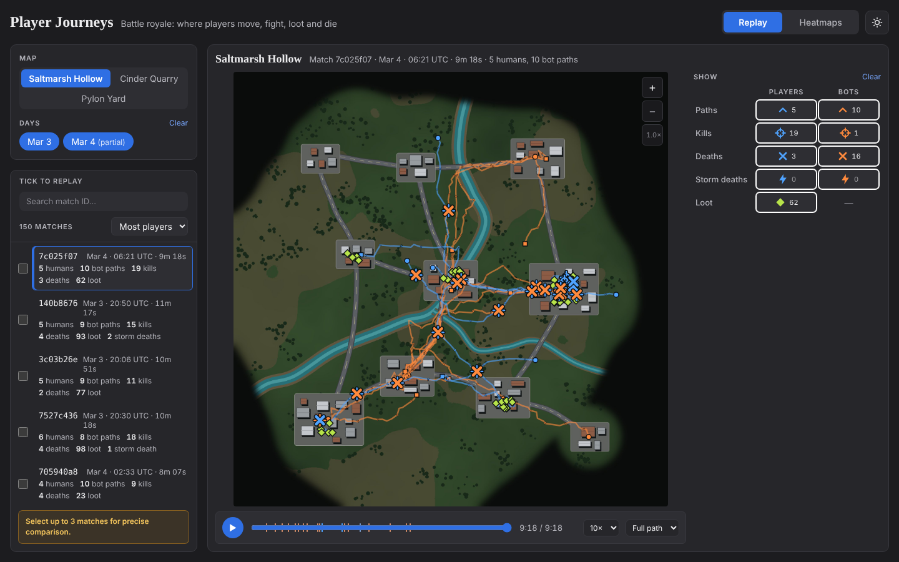
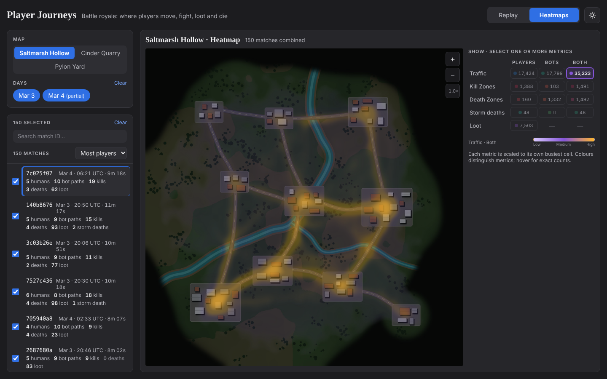

# Player Journeys

Explore where players move, fight, loot, and die across **battle royale** matches. Built specifically for level designers, this web app turns game telemetry into clear, interactive visualisations so you can inspect player behaviour quickly and easily.

It ships with a **synthetic demo dataset**: 3 original maps (Saltmarsh Hollow, Cinder Quarry, Pylon Yard) and 2 days of generated matches, made by the scripts in [`datagen/`](datagen). No real players or real game data are included.

**Live demo:** [add your deployment URL]




## How to use

- Choose a **map** and **day range**. Search for a match ID or sort the match list by players, newest, kills, loot, and other available fields.
- **Replay:** Select a match and press Play to follow player movement through the match. Toggle the available layers to inspect **Paths, Kills, Deaths, Storm deaths,** and **Loot**. Players are shown in blue and bots in orange.
- **Heatmaps:** Choose a metric — **Traffic, Kills, Deaths, Storm deaths,** or **Loot** — and select **Players, Bots,** or **Both** where available. Tick the checkboxes beside multiple matches to combine and compare their data in a single heatmap view. Hover over hotspots on the map to see exact counts.
- **Navigate the map:** Use the mouse wheel or the +/− controls to zoom, and drag to pan.
- **Switch themes:** Use the sun/moon control to switch between light and dark themes.

## Reading the data

The visualisations are built from match telemetry, including player positions and recorded in-game events.

- **Paths** show recorded player movement throughout a match.
- **Kills** show where eliminations occurred.
- **Deaths** show where players were eliminated.
- **Storm deaths** show where players were eliminated by the storm.
- **Loot** shows where loot events were recorded.
- **Traffic** represents the number of different players who visited an area. It measures how many players passed through an area, not how long they stayed there.
- **Heatmap intensity** is relative to the busiest location in the data currently displayed. Hover over a hotspot to inspect its exact count.
- **Time values** are displayed in UTC.

## Tech stack

- **Data pipeline:** Python 3, pandas, and PyArrow
- **Frontend:** JavaScript, React 18, and Vite 5
- **Map visualisation:** HTML Canvas
- **Testing and code quality:** pytest, Vitest, and ESLint
- **Hosting:** Vercel (static site)

## Data source

The pipeline reads a `player_data/` folder of Parquet telemetry: one file per player per match (`{user_id}_{match_id}.nakama-0`), with player positions, events, user IDs, match IDs and timestamps. It is cleaned, transformed and exported as static JSON for the web app.

The included demo data is generated by `datagen/`: original minimaps and 2 days of simulated matches in exactly this format, including the quirks real telemetry has (seconds stored in a milliseconds column, duplicate rows, missed snapshots, a partial last day). The generated `web/public/data` is committed, so the app runs without regenerating anything.

## Run locally

### Requirements

- Python 3.10+
- Node.js 18+

### Install dependencies and generate the data

The repository already contains generated web data. To rebuild it from scratch:

```bash
pip install -r pipeline/requirements.txt

# 1. Generate the demo dataset (original maps + 2 days of matches)
python datagen/make_maps.py --output ../demo_data/player_data/minimaps
python datagen/make_data.py --maps ../demo_data/player_data/minimaps --output ../demo_data/player_data

# 2. Web-sized minimaps and the web data
python pipeline/minimaps.py --input ../demo_data/player_data/minimaps --output web/public/minimaps

python pipeline/preprocess.py \
  --input ../demo_data/player_data \
  --output web/public/data
```

### Start the web app

```bash
cd web
npm install
npm run dev
```

The app does not require environment variables.

### Run tests and lint

From the repository root:

```bash
python -m pytest pipeline/tests
```

From the `web/` directory:

```bash
npm test
npm run lint
```

## Repository structure

```text
datagen/        Demo dataset generator: original minimaps + simulated matches

pipeline/       Data loading, cleaning, transformation, and export
                Pipeline tests and DATA_CONTRACT.md

web/src/        React application
  components/   UI components
  renderer/     Canvas drawing
  lib/          Shared logic and unit tests
  config/       Layer and metric configuration
  theme/        Colours and sizing
  hooks/        React hooks
  data/         Data access

web/public/     Minimap images and generated data
```

## Documentation

- [ARCHITECTURE.md](ARCHITECTURE.md) — system design, data flow, coordinate mapping, assumptions, and trade-offs
- [INSIGHTS.md](INSIGHTS.md) — gameplay and level-design observations from the data
- [pipeline/DATA_CONTRACT.md](pipeline/DATA_CONTRACT.md) — data pipeline contract
